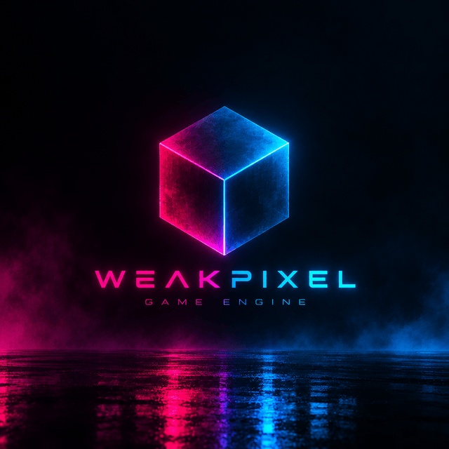

# Weakpixel Engine

`github.com/weakpixel/engine` is a small 2D game engine for Go on [Ebiten](https://ebitengine.org). Games are built from plain-struct components on an archetype-based Entity Component System; levels and prefabs are JSON files of typed "Game Objects" that a code generator derives from annotated Go structs. Around that sit asset loading with hot reload, sprite, text and shader rendering, animation, tilemaps, collision and physics, audio and dialogue voices, input mapping, rooms, browser builds, command-line tools and a level editor. Everything targets Go 1.27.

The engine builds on three standalone modules with no dependencies of their own:

| Module | What it is |
| --- | --- |
| [github.com/weakpixel/ecs](https://github.com/weakpixel/ecs) | `World`, entities, components, views, queries, resources; `ecs/system` for schedules, commands and events |
| [github.com/weakpixel/asset](https://github.com/weakpixel/asset) | Handles, stores, scopes, background loading, hot reload; `httpfs` for browser builds |
| [github.com/weakpixel/voice](https://github.com/weakpixel/voice) | Dialogue text to musical gibberish on a small synthesizer |

## What is in this module

| Part | Import path | What it is |
| --- | --- | --- |
| Engine Runtime | `github.com/weakpixel/engine/game`, `gfx`, `render`, `anim`, `tilemap`, `collision`, `physics`, `sound`, `speech`, `input`, `room`, ... | The 2D runtime: [engine guide](doc/guide/engine/README.md), start with [`game.Engine`](doc/guide/engine/engine.md) |
| GOD runtime | `github.com/weakpixel/engine/god` | Registered Game Object schemas, JSON loading and saving |
| Generator | `go run github.com/weakpixel/engine/tools/weakpixel gen` | `// +game:*` markers to typed views and GOD files (`<god.specs>/<group>.god.json`) |
| Tools | `github.com/weakpixel/engine/tools/weakpixel` | `new`, `gen`, `doc`, `assets`, `anim`, `serve`, `mcp` and more ([tools](doc/guide/tools.md)) |
| Editor | `github.com/weakpixel/engine/editor/...`, `tools/weakpixel-editor` | The level editor core for the VSCode extension and the tool shell ([editor](doc/guide/engine/editor.md)) |
| Math | `github.com/weakpixel/engine/xmath` | `float32` vectors, rectangles and matrices |

`god` imports only the ECS module and the standard library, so a program that uses just the ECS and Game Objects compiles no Ebiten code.

## Quick start

A new game, ready to run, test, build for the browser and edit in VSCode ([weakpixel new](doc/guide/tools.md#new)):

```bash
go run github.com/weakpixel/engine/tools/weakpixel@latest new mygame
cd mygame && go run .
```

Or add the engine to an existing module:

```bash
go get github.com/weakpixel/engine
```

## Documentation

All documentation lives in [doc/](doc/README.md), in two parts:

- **[Guide](doc/README.md#guide)**, for people who make games with the engine: Game Objects and GOD, the Engine Runtime and the tools. The ECS has its own [guide](https://github.com/weakpixel/ecs/blob/main/doc/README.md), and so has the [asset system](https://github.com/weakpixel/asset/blob/main/doc/guide.md).
- **[Design](doc/design/README.md)**, for people who work on the engine: architecture, generator, asset library, renderer and editor, with the reasons behind them and what is not built yet.

## Development

```bash
make all                      # go generate, fmt, build, test, vet and the display tests
make wasm-build               # js/wasm cross-build
make wasm-test                # js/wasm tests under Node
make bench name=<label>       # god benchmarks, write bench/<label>.txt
make benchcmp new=<label>     # benchstat bench/baseline.txt vs bench/<label>.txt
make engine-bench name=<label> # engine package benchmarks, write bench/engine-<label>.txt
```

Generated files (every `zz__gen.go` and the GOD files under `godspecs/`) are never edited by hand: change the generator and run `go generate ./...`. Contributor rules are in [CLAUDE.md](CLAUDE.md) and the [design docs](doc/design/README.md).

## License

MIT, see [LICENSE](LICENSE). Third-party notices: [THIRD_PARTY_NOTICES.md](THIRD_PARTY_NOTICES.md).
